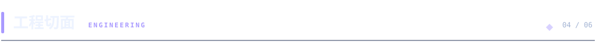
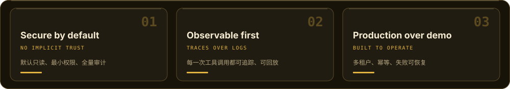
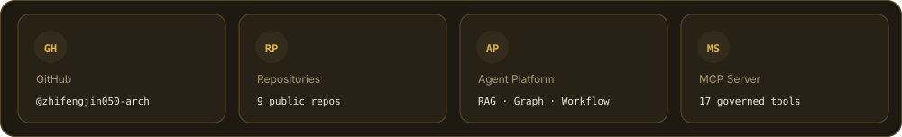

<picture>
  <source media="(prefers-color-scheme: dark)" srcset="assets/banner-dark.svg">
  <source media="(prefers-color-scheme: light)" srcset="assets/banner-light.svg">
  
</picture>

<picture>
  <source media="(prefers-color-scheme: dark)" srcset="assets/typing-dark.svg">
  <source media="(prefers-color-scheme: light)" srcset="assets/typing-light.svg">
  
</picture>

 

<picture>
  <source media="(prefers-color-scheme: dark)" srcset="assets/divider-dark.svg">
  <source media="(prefers-color-scheme: light)" srcset="assets/divider-light.svg">
  
</picture>

<picture>
  <source media="(prefers-color-scheme: dark)" srcset="assets/hdr-about-dark.svg">
  <source media="(prefers-color-scheme: light)" srcset="assets/hdr-about-light.svg">
  
</picture>

## 定位 / What I build

- **定位**：构建让 AI Agent 在真实基础设施上受控运行的系统 —— 不是聊天机器人 demo。
- **关注边界**：多租户隔离、最小权限、工具执行门、全链路 trace；先解决「能不能上线」，再谈能力上限。
- **开源交付**：[enterprise-ai-agent-platform](https://github.com/zhifengjin050-arch/enterprise-ai-agent-platform) · [enterprise-ai-sre-platform](https://github.com/zhifengjin050-arch/enterprise-ai-sre-platform) · [enterprise-devops-mcp-server](https://github.com/zhifengjin050-arch/enterprise-devops-mcp-server)，Apache-2.0 / MIT，README 含架构图与部署说明。
- **评价方式**：看默认安全配置、失败恢复路径与可观测性，而不是看演示视频。

> **Design constraint:** an agent that can call `kubectl` is a production system, not a prompt. Every tool call must be authorized, bounded, and replayable.

<picture>
  <source media="(prefers-color-scheme: dark)" srcset="assets/terminal-dark.svg">
  <source media="(prefers-color-scheme: light)" srcset="assets/terminal-light.svg">
  
</picture>

<picture>
  <source media="(prefers-color-scheme: dark)" srcset="assets/hdr-stack-dark.svg">
  <source media="(prefers-color-scheme: light)" srcset="assets/hdr-stack-light.svg">
  
</picture>

<picture>
  <source media="(prefers-color-scheme: dark)" srcset="assets/arch-dark.svg">
  <source media="(prefers-color-scheme: light)" srcset="assets/arch-light.svg">
  
</picture>

<table>
<tr>
<td valign="top" width="50%">

**运行时 · 协议**

</td>

<td valign="top" width="50%">

**检索 · 数据**

</td>

</tr>
<tr>
<td valign="top" colspan="2">

**平台 · 交付**

</td>

</tr>
</table>

<picture>
  <source media="(prefers-color-scheme: dark)" srcset="assets/hdr-projects-dark.svg">
  <source media="(prefers-color-scheme: light)" srcset="assets/hdr-projects-light.svg">
  
</picture>

  <a href="https://github.com/zhifengjin050-arch/enterprise-ai-agent-platform">
    <picture>
      <source media="(prefers-color-scheme: dark)" srcset="assets/proj-agent-platform-dark.svg">
      <source media="(prefers-color-scheme: light)" srcset="assets/proj-agent-platform-light.svg">
      
    </picture>
  </a>

  <a href="https://github.com/zhifengjin050-arch/enterprise-ai-sre-platform">
    <picture>
      <source media="(prefers-color-scheme: dark)" srcset="assets/proj-sre-platform-dark.svg">
      <source media="(prefers-color-scheme: light)" srcset="assets/proj-sre-platform-light.svg">
      
    </picture>
  </a>

  <a href="https://github.com/zhifengjin050-arch/enterprise-devops-mcp-server">
    <picture>
      <source media="(prefers-color-scheme: dark)" srcset="assets/proj-mcp-server-dark.svg">
      <source media="(prefers-color-scheme: light)" srcset="assets/proj-mcp-server-light.svg">
      
    </picture>
  </a>

  <a href="https://github.com/zhifengjin050-arch/new-api">
    <picture>
      <source media="(prefers-color-scheme: dark)" srcset="assets/proj-api-gateway-dark.svg">
      <source media="(prefers-color-scheme: light)" srcset="assets/proj-api-gateway-light.svg">
      
    </picture>
  </a>

  <a href="https://github.com/zhifengjin050-arch/dujiao-next">
    <picture>
      <source media="(prefers-color-scheme: dark)" srcset="assets/proj-dujiao-next-dark.svg">
      <source media="(prefers-color-scheme: light)" srcset="assets/proj-dujiao-next-light.svg">
      
    </picture>
  </a>

  <a href="https://github.com/zhifengjin050-arch/ldap-radius-unifi-auth">
    <picture>
      <source media="(prefers-color-scheme: dark)" srcset="assets/proj-infra-automation-dark.svg">
      <source media="(prefers-color-scheme: light)" srcset="assets/proj-infra-automation-light.svg">
      
    </picture>
  </a>

<picture>
  <source media="(prefers-color-scheme: dark)" srcset="assets/hdr-stats-dark.svg">
  <source media="(prefers-color-scheme: light)" srcset="assets/hdr-stats-light.svg">
  
</picture>

<picture>
  <source media="(prefers-color-scheme: dark)" srcset="assets/stats-dark.svg">
  <source media="(prefers-color-scheme: light)" srcset="assets/stats-light.svg">
  
</picture>

<picture>
  <source media="(prefers-color-scheme: dark)" srcset="assets/flow-dark.svg">
  <source media="(prefers-color-scheme: light)" srcset="assets/flow-light.svg">
  
</picture>

<picture>
  <source media="(prefers-color-scheme: dark)" srcset="assets/hdr-focus-dark.svg">
  <source media="(prefers-color-scheme: light)" srcset="assets/hdr-focus-light.svg">
  
</picture>

<picture>
  <source media="(prefers-color-scheme: dark)" srcset="assets/focus-dark.svg">
  <source media="(prefers-color-scheme: light)" srcset="assets/focus-light.svg">
  
</picture>

<picture>
  <source media="(prefers-color-scheme: dark)" srcset="assets/hdr-links-dark.svg">
  <source media="(prefers-color-scheme: light)" srcset="assets/hdr-links-light.svg">
  
</picture>

<picture>
  <source media="(prefers-color-scheme: dark)" srcset="assets/links-dark.svg">
  <source media="(prefers-color-scheme: light)" srcset="assets/links-light.svg">
  
</picture>

<picture>
  <source media="(prefers-color-scheme: dark)" srcset="assets/divider-dark.svg">
  <source media="(prefers-color-scheme: light)" srcset="assets/divider-light.svg">
  
</picture>

**先看默认安全配置，再看功能演示。**

