

<picture>
  <source media="(prefers-color-scheme: dark)" srcset="assets/banner-dark.svg">
  <source media="(prefers-color-scheme: light)" srcset="assets/banner-light.svg">
  
</picture>
<picture>
  <source media="(prefers-color-scheme: dark)" srcset="assets/typing-dark.svg">
  <source media="(prefers-color-scheme: light)" srcset="assets/typing-light.svg">
  
</picture>

**AI Agent · AIOps · Platform Engineering**

让知识可检索，让工具可治理，让系统可观测。

[👋 关于我](#about) · [🚀 代表项目](#projects) · [🛠️ 技术能力](#stack) · [📚 技术笔记](#notes) · [🤝 交流合作](#contact)

<h2><picture>  <source media="(prefers-color-scheme: dark)" srcset="assets/hdr-about-dark.svg">  <source media="(prefers-color-scheme: light)" srcset="assets/hdr-about-light.svg">  </picture></h2>

- 👋 你好，我是 **Zhifeng Jin**，关注 **AI Agent 应用开发、AIOps 与平台工程**，喜欢把知识检索、工具调用和基础设施自动化连成完整系统。
- 🧠 **AI 应用**：围绕企业文档接入、Hybrid RAG、知识图谱与 Agent Runtime，探索从「找到信息」到「执行任务」的工程链路。
- ☁️ **云原生与运维**：围绕 Kubernetes 故障诊断、MCP 工具治理与服务可观测性，让模型决策有证据、工具执行有边界。
- 🛠️ **工程实践**：主要使用 Python / FastAPI，结合 Go、React / Vue 与 TypeScript，关注 API、数据层、控制台和部署之间的协作。
- 📦 **作品入口**：下面整理了 3 个 AI / 运维核心项目与 3 个网关、全栈、网络认证实践；每项均附仓库与可继续阅读的技术资料。
- 🌱 **持续探索**：检索质量评估、Agent 执行可靠性、权限边界与故障恢复；欢迎交流实现思路，也欢迎带着具体问题来讨论。

> ✨ **我的工程兴趣**：把文档、模型、工具和基础设施连接起来，做出能解释、能部署、能继续演进的系统。

<picture>
  <source media="(prefers-color-scheme: dark)" srcset="assets/capability-dark.svg">
  <source media="(prefers-color-scheme: light)" srcset="assets/capability-light.svg">
  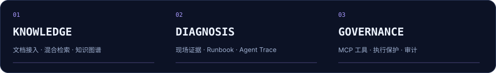
</picture>

### 🧭 从哪里开始看？

- **想了解 AI 应用开发** → 从企业知识库 Agent 入手，看连接器、Hybrid RAG、知识图谱与工作流。
- **想了解 AIOps / SRE** → 从故障诊断 Agent 入手，看 Kubernetes 现场证据、Runbook 与 Trace。
- **想了解 MCP / 工具工程** → 从 DevOps MCP Server 入手，看工具目录、执行门与审计。

<h2><picture>  <source media="(prefers-color-scheme: dark)" srcset="assets/hdr-stack-dark.svg">  <source media="(prefers-color-scheme: light)" srcset="assets/hdr-stack-light.svg">  </picture></h2>

<picture>
  <source media="(prefers-color-scheme: dark)" srcset="assets/languages-dark.svg">
  <source media="(prefers-color-scheme: light)" srcset="assets/languages-light.svg">
  
</picture>

<table width="100%">
<tr>
<td valign="top" width="50%"><h4>⚙️ 后端 · 服务</h4>

 
 
 
 
 

</td>
<td valign="top" width="50%"><h4>🎨 前端 · 工程</h4>

 
 
 
 
 

</td>
</tr>
<tr>
<td valign="top" width="50%"><h4>🧠 AI · 智能体</h4>

 
 
 
 
 

</td>
<td valign="top" width="50%"><h4>🗄️ 数据 · 缓存</h4>

 
 
 
 
 

</td>
</tr>
<tr>
<td valign="top" width="50%"><h4>☁️ 云原生 · 工具链</h4>

 
 
 
 
 
 

</td>
<td valign="top" width="50%"><h4>🔎 观测 · 权限</h4>

 
 
 
 
 
 

</td>
</tr>
</table>

上列技术覆盖当前公开项目中的应用与集成实践，具体实现见各项目源码。

📐 展开技术说明与系统架构

### 🧠 AI / Agent / Retrieval

- **Agent 编排**：LangGraph、Planner、Tool Calling、Memory、MCP 工具发现与调用。
- **知识工程**：文档接入、分块、Embedding、向量与全文混合检索、知识图谱、Rerank 与引用回答。
- **工作流**：DAG、审批节点、Webhook / Schedule 触发与执行生命周期。

### ⚙️ Backend / Data / Product

- **后端与 API**：Python、FastAPI、SQLAlchemy async、Alembic；Go 服务与网关实践。
- **数据与缓存**：PostgreSQL、Redis、ChromaDB；关注租户约束、数据模型与异步任务协作。
- **控制台与全栈**：React / Vue 3、TypeScript、Vite、Tailwind；将业务接口与可操作界面连接起来。

### ☁️ Infrastructure / Security / Delivery

- **基础设施**：Linux、Docker、Kubernetes、SSH，以及 LDAP / FreeRADIUS / UniFi 集成实践。
- **权限与治理**：JWT、RBAC、多租户隔离、工具风险分级、执行保护与审计日志。
- **交付与观测**：Docker Compose、Kubernetes manifests、Helm、GitHub Actions、OpenTelemetry、Prometheus 与 Grafana。

<picture>
  <source media="(prefers-color-scheme: dark)" srcset="assets/arch-dark.svg">
  <source media="(prefers-color-scheme: light)" srcset="assets/arch-light.svg">
  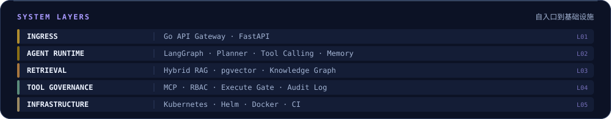
</picture>

### 🔗 把这些技术放进一条链路

<picture>
  <source media="(prefers-color-scheme: dark)" srcset="assets/flow-dark.svg">
  <source media="(prefers-color-scheme: light)" srcset="assets/flow-light.svg">
  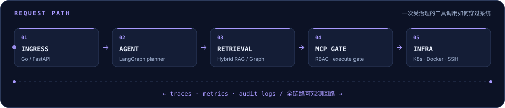
</picture>

*上图为项目能力的组合示意，各项目实际集成范围见对应仓库。*

<h2><picture>  <source media="(prefers-color-scheme: dark)" srcset="assets/hdr-projects-dark.svg">  <source media="(prefers-color-scheme: light)" srcset="assets/hdr-projects-light.svg">  </picture></h2>

以 **知识自动化 → 故障诊断 → 工具治理** 为主线，下面展开项目场景、系统能力与值得深入阅读的工程设计。

### 🧠 01 · [企业级 AI Agent 平台](https://github.com/zhifengjin050-arch/enterprise-ai-agent-platform)

**KNOWLEDGE × AGENT** · `Python` / `FastAPI` / `Apache-2.0`

<a href="https://github.com/zhifengjin050-arch/enterprise-ai-agent-platform">
<picture>
  <source media="(prefers-color-scheme: dark)" srcset="assets/proj-agent-platform-dark.svg">
  <source media="(prefers-color-scheme: light)" srcset="assets/proj-agent-platform-light.svg">
  
</picture>
</a>

面向企业内部文档分散、知识检索与流程执行割裂的问题，组织连接器、知识处理、检索增强与 Agent 工作流，形成可私有化部署的知识自动化平台。

🔬 技术实现与工程细节

- **文档接入与同步**：飞书 / 语雀 / GitLab 连接器统一接入，配合全量与增量同步、作业调度和失败重试，管理知识进入系统的过程。
- **混合检索链路**：文档分块与 Embedding 后，融合向量检索、全文检索与知识图谱，支持可选 Rerank 和带引用回答，兼顾语义召回与事实定位。
- **Agent 与工作流**：Planner、Tool Registry、Memory 与 LLM Gateway 协作，通过 DAG、审批节点及 API / Webhook / Schedule 触发器组织任务执行。
- **平台工程**：JWT / RBAC / 租户隔离覆盖数据访问；OpenTelemetry、Prometheus 与 Grafana 提供观测入口，交付 Compose、Kubernetes 清单与 Helm Chart。

> 🔧 重点关注：检索融合、权限约束与异步任务生命周期，避免知识链路和执行链路各自孤立。

[💻 源码](https://github.com/zhifengjin050-arch/enterprise-ai-agent-platform) · [🎬 演示](https://zhifengjin050-arch.github.io/enterprise-ai-agent-platform/) · [📐 架构](https://github.com/zhifengjin050-arch/enterprise-ai-agent-platform/blob/main/docs/images/system_architecture.md) · [🧩 功能矩阵](https://github.com/zhifengjin050-arch/enterprise-ai-agent-platform/blob/main/docs/showcase/FEATURE_MATRIX.md)

🖼️ 展开项目演示入口

点击封面前往演示页，项目架构、部署方法与功能边界见仓库文档。

---

### 🔎 02 · [自治式 AIOps / SRE 平台](https://github.com/zhifengjin050-arch/enterprise-ai-sre-platform)

**INCIDENT × EVIDENCE** · `LangGraph` / `MCP` / `Kubernetes`

<a href="https://github.com/zhifengjin050-arch/enterprise-ai-sre-platform">
<picture>
  <source media="(prefers-color-scheme: dark)" srcset="assets/proj-sre-platform-dark.svg">
  <source media="(prefers-color-scheme: light)" srcset="assets/proj-sre-platform-light.svg">
  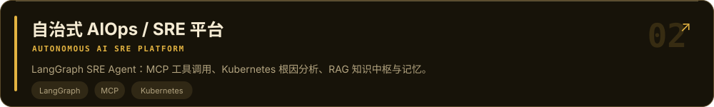
</picture>
</a>

面向 SRE / DevOps 的故障诊断场景，将自然语言故障描述转为工具规划、现场证据采集、Runbook 检索与结构化 Incident Report。

🔬 技术实现与工程细节

- **多步诊断**：LangGraph 组织 agent → tools → agent 循环，结合会话与工作记忆推进根因分析，支持 Kubernetes、Docker 与 SSH 工具发现和调用。
- **典型故障场景**：覆盖 CrashLoopBackOff、OOMKilled、ImagePullBackOff 与 502 / 503 等排查入口，将资源状态、日志与知识库信息放入同一诊断上下文。
- **知识与权限**：Runbook / SOP 检索结合飞书同步，以 organization_id 约束知识访问，并通过 JWT / RBAC 组织多租户入口。
- **诊断过程可见**：Agent Trace 记录工具调用与耗时，SSE 向 React 控制台流式输出；PostgreSQL、Prometheus / Grafana 与 Compose 组成数据、观测和部署基础。

> 🔧 重点关注：诊断结论与证据之间的对应关系，以及多步工具调用过程的可追踪性。

[💻 源码](https://github.com/zhifengjin050-arch/enterprise-ai-sre-platform) · [🎬 演示](https://zhifengjin050-arch.github.io/enterprise-ai-sre-platform/) · [📐 架构](https://github.com/zhifengjin050-arch/enterprise-ai-sre-platform/blob/main/docs/ARCHITECTURE.md) · [🚀 部署](https://github.com/zhifengjin050-arch/enterprise-ai-sre-platform/blob/main/docs/DEPLOYMENT.md)

🖼️ 展开项目演示入口

点击封面前往演示页，项目架构、部署方法与功能边界见仓库文档。

---

### 🛡️ 03 · [DevOps MCP Server](https://github.com/zhifengjin050-arch/enterprise-devops-mcp-server)

**PROTOCOL × GOVERNANCE** · `MCP` / `Docker` / `SSH`

<a href="https://github.com/zhifengjin050-arch/enterprise-devops-mcp-server">
<picture>
  <source media="(prefers-color-scheme: dark)" srcset="assets/proj-mcp-server-dark.svg">
  <source media="(prefers-color-scheme: light)" srcset="assets/proj-mcp-server-light.svg">
  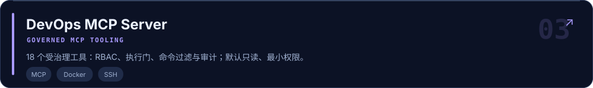
</picture>
</a>

为 MCP 客户端提供 Linux、Docker、Kubernetes 与 SSH 运维工具，把基础设施能力封装为有明确权限与风险分级的协议接口。

🔬 技术实现与工程细节

- **18 个工具**：包含健康检查、CPU / 内存 / 磁盘、进程、容器日志、Kubernetes 资源与 SSH 等工具，目录显式标注风险级别和权限要求。
- **默认只读**：EXECUTE_TOOLS_ENABLED=false；通过模块白名单、执行保护与命令过滤约束操作范围，将只读检查与高风险动作分开处理。
- **执行确认与审计**：提供 confirm_execute_action 和 get_audit_logs 等接口，为客户端调用建立确认与记录入口。
- **接入与交付**：提供 Cursor MCP 配置示例、工具枚举脚本、Docker Compose 与 CI 配置，方便从本地验证逐步接入 Agent 系统。

> 🔧 重点关注：工具 Schema、风险分级、执行开关和审计记录如何共同约束模型的操作边界。

[💻 源码](https://github.com/zhifengjin050-arch/enterprise-devops-mcp-server) · [🎬 演示](https://zhifengjin050-arch.github.io/enterprise-devops-mcp-server/) · [📐 架构](https://github.com/zhifengjin050-arch/enterprise-devops-mcp-server/blob/main/docs/architecture.md) · [🔐 安全设计](https://github.com/zhifengjin050-arch/enterprise-devops-mcp-server/blob/main/SECURITY.md)

---

<h2><picture>  <source media="(prefers-color-scheme: dark)" srcset="assets/hdr-portfolio-dark.svg">  <source media="(prefers-color-scheme: light)" srcset="assets/hdr-portfolio-light.svg">  </picture></h2>

补充展示模型网关、全栈业务与网络认证三个方向。以下介绍仓库能力与实践主题；具体实现与许可说明以各仓库为准。

### ⚡ 04 · [多模型 API 网关](https://github.com/zhifengjin050-arch/new-api)

**GATEWAY × AI API** · `Go` / `Gateway` / `AGPL-3.0`

<a href="https://github.com/zhifengjin050-arch/new-api">
<picture>
  <source media="(prefers-color-scheme: dark)" srcset="assets/proj-api-gateway-dark.svg">
  <source media="(prefers-color-scheme: light)" srcset="assets/proj-api-gateway-light.svg">
  
</picture>
</a>

多模型统一接入与 AI 资产管理实践，围绕模型渠道、通道池、动态计价与负载均衡梳理 AI 服务网关的核心能力。

🔬 技术实现与工程细节

- **系统视角**：关注请求从统一 API 入口到模型渠道的路由过程，以及渠道管理、计费规则与可用性之间的关系。
- **阅读入口**：仓库包含中文说明、完整英文文档与 web/ 前端；保留仓库及上游许可声明。

> 🔧 开源实践方向：模型服务接入、网关路由与管理控制台。

[💻 源码](https://github.com/zhifengjin050-arch/new-api)

---

### 🦄 05 · [全栈交易系统](https://github.com/zhifengjin050-arch/dujiao-next)

**FULL STACK × DELIVERY** · `Go` / `Vue 3` / `PostgreSQL`

<a href="https://github.com/zhifengjin050-arch/dujiao-next">
<picture>
  <source media="(prefers-color-scheme: dark)" srcset="assets/proj-dujiao-next-dark.svg">
  <source media="(prefers-color-scheme: light)" srcset="assets/proj-dujiao-next-light.svg">
  
</picture>
</a>

Go + Vue 3 / TypeScript 的虚拟商品交易与自动发货系统实践，覆盖用户前台、管理后台与 API 服务。

🔬 技术实现与工程细节

- **交易链路**：围绕商品、购物车、订单、支付与自动发货组织业务模块，支持多支付渠道与多语言、多币种场景。
- **后端与安全**：按公开、用户、管理、上游与渠道划分 API；使用独立用户 / 管理员 JWT、登录限流与敏感数据加密。
- **数据与部署**：SQLite / PostgreSQL、Redis 与异步队列配置，配套容器化部署及生产配置说明。

> 🔧 开源实践方向：业务状态流转、API 权限分层与前后端交付。

[💻 源码](https://github.com/zhifengjin050-arch/dujiao-next)

---

### 🌐 06 · [基础设施自动化](https://github.com/zhifengjin050-arch/ldap-radius-unifi-auth)

**IDENTITY × NETWORK** · `Docker` / `Python` / `FreeRADIUS`

<a href="https://github.com/zhifengjin050-arch/ldap-radius-unifi-auth">
<picture>
  <source media="(prefers-color-scheme: dark)" srcset="assets/proj-infra-automation-dark.svg">
  <source media="(prefers-color-scheme: light)" srcset="assets/proj-infra-automation-light.svg">
  
</picture>
</a>

将 Go-Ldap-Admin、OpenLDAP、FreeRADIUS 与 UniFi 组合为企业无线网络认证方案，围绕统一账号、802.1X 接入与部门网络隔离整理部署实践。

🔬 技术实现与工程细节

- **统一身份**：通过 LDAP 管理账号与组织信息，由 FreeRADIUS 对接认证，再接入 UniFi 无线网络。
- **动态 VLAN**：将 LDAP 部门属性映射到 RADIUS 响应，按部门下发 VLAN，减少为每个组织单独配置 SSID 的复杂度。
- **部署与排障**：提供 Compose 部署、配置路径、权限处理、RADIUS Debug 与 radtest 调试说明。

> 🔧 工程实践方向：身份系统集成、协议配置与可复现排障。

[💻 源码](https://github.com/zhifengjin050-arch/ldap-radius-unifi-auth)

---

<h2><picture>  <source media="(prefers-color-scheme: dark)" srcset="assets/hdr-notes-dark.svg">  <source media="(prefers-color-scheme: light)" srcset="assets/hdr-notes-light.svg">  </picture></h2>

将项目文档作为技术笔记入口，沿着一个问题读到设计与实现：

- **[🔍 企业知识如何进入 RAG？](https://github.com/zhifengjin050-arch/enterprise-ai-agent-platform#rag-pipeline)** — 从文档同步、智能分块读到混合检索、图谱与引用回答。
- **[🧩 Agent 如何执行多步任务？](https://github.com/zhifengjin050-arch/enterprise-ai-agent-platform#核心能力)** — 从 Planner、工具注册与 Memory 读到工作流编排。
- **[🩺 故障诊断如何组织证据？](https://github.com/zhifengjin050-arch/enterprise-ai-sre-platform#features)** — 从 LangGraph Agent 循环读到 Kubernetes 工具、Runbook 与 Incident Report。
- **[🔐 MCP 如何划分读与写？](https://github.com/zhifengjin050-arch/enterprise-devops-mcp-server#mcp-tool-catalog)** — 从工具目录的风险 / 权限读到默认只读与执行保护。
- **[📦 系统如何交付？](https://github.com/zhifengjin050-arch/enterprise-ai-agent-platform#部署架构)** — 从环境配置与 Compose 读到 Kubernetes 和 Helm 部署入口。
<h2><picture>  <source media="(prefers-color-scheme: dark)" srcset="assets/hdr-focus-dark.svg">  <source media="(prefers-color-scheme: light)" srcset="assets/hdr-focus-light.svg">  </picture></h2>

- **检索质量**：如何组织评测样本、定位召回与排序问题，让回答更有依据。
- **执行可靠性**：如何处理超时、重试、部分失败与长任务状态，让 Agent 任务更可控。
- **可观测性**：如何把模型决策、工具调用、耗时与成本放入同一个分析上下文。
- **平台体验**：如何降低系统配置、知识接入与工具集成的使用门槛。

<h2><picture>  <source media="(prefers-color-scheme: dark)" srcset="assets/hdr-principles-dark.svg">  <source media="(prefers-color-scheme: light)" srcset="assets/hdr-principles-light.svg">  </picture></h2>

- 🛡️ **边界明确**：权限、租户、数据访问与执行范围应在接口和实现中看得见。
- 🔎 **过程可查**：错误要能定位，工具调用要有记录，结论要有证据。
- 📦 **交付完整**：代码之外，补上配置模板、启动方式、部署入口与技术文档。
- 🧱 **持续演进**：先理清模块职责，再扩展能力；让后续阅读和修改都有路径。

<h2><picture>  <source media="(prefers-color-scheme: dark)" srcset="assets/hdr-links-dark.svg">  <source media="(prefers-color-scheme: light)" srcset="assets/hdr-links-light.svg">  </picture></h2>

欢迎围绕 **Agent 工程、RAG、MCP、Kubernetes 诊断、平台工程** 交流。发现问题或有改进建议，可以在对应仓库提交 Issue / PR。

[🐙 GitHub](https://github.com/zhifengjin050-arch) · [📂 所有仓库](https://github.com/zhifengjin050-arch?tab=repositories) · [🧠 Agent Platform](https://github.com/zhifengjin050-arch/enterprise-ai-agent-platform) · [🛡️ MCP Server](https://github.com/zhifengjin050-arch/enterprise-devops-mcp-server)

---

**把想法写成代码，把系统做得清晰可靠。欢迎交流，也感谢每一份反馈 ✨**

如果某个项目对你有帮助，欢迎留下一个 ⭐

