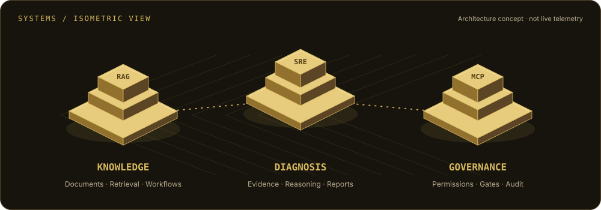

<a href="https://github.com/zhifengjin050-arch">简体中文</a> &nbsp;|&nbsp; <a href="https://github.com/zhifengjin050-arch/zhifengjin050-arch/blob/main/README_EN.md">English</a>

<picture>
  <source media="(prefers-color-scheme: dark)" srcset="assets/banner-en-dark.svg">
  <source media="(prefers-color-scheme: light)" srcset="assets/banner-en-light.svg">
  
</picture>

**AI Agent · AIOps · Platform Engineering**

Make knowledge searchable, tools governed, and systems observable.

[About](#about) · [Tech Stack](#stack) · [Projects](#projects) · [Notes](#notes) · [Connect](#contact)

 &nbsp;  &nbsp; 

### 🎬 Project Preview

<table width="100%"><tr>
<td width="33%" valign="top"><h4>01 · Knowledge Agent</h4>
Documents → Retrieval → Workflow

<a href="https://zhifengjin050-arch.github.io/enterprise-ai-agent-platform/">▶ Watch demo</a> · <a href="https://github.com/zhifengjin050-arch/enterprise-ai-agent-platform">Source ↗</a>
</td>
<td width="33%" valign="top"><h4>02 · SRE Diagnosis</h4>
Evidence → Runbooks → Reports

<a href="https://zhifengjin050-arch.github.io/enterprise-ai-sre-platform/">▶ Watch demo</a> · <a href="https://github.com/zhifengjin050-arch/enterprise-ai-sre-platform">Source ↗</a>
</td>
<td width="33%" valign="top"><h4>03 · MCP Tooling</h4>
Tool schemas → Gates → Audit

<a href="https://zhifengjin050-arch.github.io/enterprise-devops-mcp-server/">▶ Watch demo</a> · <a href="https://github.com/zhifengjin050-arch/enterprise-devops-mcp-server">Source ↗</a>
</td>
</tr></table>

<h2><picture>  <source media="(prefers-color-scheme: dark)" srcset="assets/hdr-about-en-dark.svg">  <source media="(prefers-color-scheme: light)" srcset="assets/hdr-about-en-light.svg">  </picture></h2>

- 👋 Hi, I'm **Zhifeng Jin**. I work on **AI Agent applications, AIOps and platform engineering**, connecting knowledge retrieval, tool calling and infrastructure automation.
- 🧠 **AI applications**: document connectors, Hybrid RAG, knowledge graphs and Agent runtimes that connect information with actionable workflows.
- ☁️ **Infrastructure**: Kubernetes diagnosis, governed MCP tools and observability, with attention to evidence, permissions and execution boundaries.
- 🛠️ **Engineering**: Python / FastAPI, Go, React / Vue and TypeScript across APIs, data layers, dashboards and deployment.
- 📦 **Portfolio**: three core AI / operations projects, three open-source engineering projects, and Toyouju, a job application product in development.
- 🌱 **Exploring**: retrieval evaluation, reliable Agent execution, tenant boundaries and failure recovery.

> ✨ My engineering interest: connect documents, models, tools and infrastructure into systems that are understandable, deployable and maintainable.

<picture>
  <source media="(prefers-color-scheme: dark)" srcset="assets/spatial-en-dark.svg">
  <source media="(prefers-color-scheme: light)" srcset="assets/spatial-en-light.svg">
  
</picture>

### Where to start

- **AI application engineering** → the knowledge Agent platform: connectors, retrieval, graphs and workflows.
- **AIOps / SRE** → the diagnosis platform: infrastructure evidence, runbooks and execution traces.
- **MCP engineering** → the DevOps server: tool schemas, risk classification and execution gates.

<h2><picture>  <source media="(prefers-color-scheme: dark)" srcset="assets/hdr-stack-en-dark.svg">  <source media="(prefers-color-scheme: light)" srcset="assets/hdr-stack-en-light.svg">  </picture></h2>

<table width="100%">
<tr>
<td valign="top" width="50%"><h4>Backend / Services</h4>

 
 
 
 
 

</td>
<td valign="top" width="50%"><h4>Frontend / Engineering</h4>

 
 
 
 
 

</td>
</tr>
<tr>
<td valign="top" width="50%"><h4>AI / Agents</h4>

 
 
 
 
 

</td>
<td valign="top" width="50%"><h4>Data / Cache</h4>

 
 
 
 
 

</td>
</tr>
<tr>
<td valign="top" width="50%"><h4>Cloud Native / Tooling</h4>

 
 
 
 
 
 

</td>
<td valign="top" width="50%"><h4>Observability / Access</h4>

 
 
 
 
 
 

</td>
</tr>
</table>

These technologies reflect application and integration work across the public projects; see each repository for its actual scope.

- **Agents and retrieval**: LangGraph, Planner, Tool Calling, Memory, MCP discovery, document chunking, embeddings, Hybrid RAG, knowledge graphs, reranking and citations.
- **Application engineering**: Python, FastAPI, async SQLAlchemy and Alembic; Go services and gateways; React / Vue 3, TypeScript, Vite and Tailwind.
- **Platform foundations**: PostgreSQL, Redis, ChromaDB, Docker, Kubernetes, Helm, GitHub Actions, OpenTelemetry, Prometheus and Grafana.
- **Security and integration**: JWT, RBAC, tenant isolation, tool risk classification, execution protection, audit logs and LDAP / RADIUS integration.

<h2><picture>  <source media="(prefers-color-scheme: dark)" srcset="assets/hdr-projects-en-dark.svg">  <source media="(prefers-color-scheme: light)" srcset="assets/hdr-projects-en-light.svg">  </picture></h2>

The core portfolio follows **knowledge automation → incident diagnosis → tool governance**.

### 01 · [Enterprise AI Agent Platform](https://github.com/zhifengjin050-arch/enterprise-ai-agent-platform)

<a href="https://github.com/zhifengjin050-arch/enterprise-ai-agent-platform"><picture>  <source media="(prefers-color-scheme: dark)" srcset="assets/proj-agent-platform-en-dark.svg">  <source media="(prefers-color-scheme: light)" srcset="assets/proj-agent-platform-en-light.svg">  </picture></a>

A private-deployment knowledge automation platform that connects scattered enterprise documents with retrieval, Agent planning and workflows.

🔬 Explore technical implementation

- **Document ingestion**: Feishu, Yuque and GitLab connectors with full / incremental synchronization, scheduled jobs and failure retries.
- **Hybrid retrieval**: document chunking and embeddings, vector and full-text retrieval, knowledge graphs, optional reranking and answers with citations.
- **Agent and workflows**: Planner, Tool Registry, Memory and LLM Gateway, alongside DAG workflows, approvals and API / webhook / schedule triggers.
- **Platform foundations**: JWT, RBAC and tenant isolation; OpenTelemetry, Prometheus and Grafana; Compose, Kubernetes manifests and Helm.

> 🔧 Engineering focus: Retrieval fusion, permission constraints and asynchronous task lifecycles.

[Source](https://github.com/zhifengjin050-arch/enterprise-ai-agent-platform) · [Demo](https://zhifengjin050-arch.github.io/enterprise-ai-agent-platform/) · [Architecture](https://github.com/zhifengjin050-arch/enterprise-ai-agent-platform/blob/main/docs/images/system_architecture.md) · [Reference](https://github.com/zhifengjin050-arch/enterprise-ai-agent-platform/blob/main/docs/showcase/FEATURE_MATRIX.md)

---

### 02 · [AI SRE Platform](https://github.com/zhifengjin050-arch/enterprise-ai-sre-platform)

<a href="https://github.com/zhifengjin050-arch/enterprise-ai-sre-platform"><picture>  <source media="(prefers-color-scheme: dark)" srcset="assets/proj-sre-platform-en-dark.svg">  <source media="(prefers-color-scheme: light)" srcset="assets/proj-sre-platform-en-light.svg">  </picture></a>

An incident-diagnosis application for SRE / DevOps: turn a natural-language incident into tool planning, infrastructure evidence, runbook retrieval and a structured incident report.

🔬 Explore technical implementation

- **Multi-step diagnosis**: a LangGraph agent → tools → agent loop with conversation and working memory; Kubernetes, Docker and SSH tool discovery.
- **Troubleshooting scenarios**: CrashLoopBackOff, OOMKilled, ImagePullBackOff and 502 / 503, bringing resource status, logs and knowledge into a shared context.
- **Knowledge and access**: runbook / SOP retrieval and Feishu synchronization, scoped by organization_id and exposed through JWT / RBAC.
- **Visible execution**: Agent Trace records tool calls and timing; SSE streams progress to the React console, with PostgreSQL and Compose deployment.

> 🔧 Engineering focus: Connecting diagnosis to evidence and tracing multi-step tool execution.

[Source](https://github.com/zhifengjin050-arch/enterprise-ai-sre-platform) · [Demo](https://zhifengjin050-arch.github.io/enterprise-ai-sre-platform/) · [Architecture](https://github.com/zhifengjin050-arch/enterprise-ai-sre-platform/blob/main/docs/ARCHITECTURE.md) · [Reference](https://github.com/zhifengjin050-arch/enterprise-ai-sre-platform/blob/main/docs/DEPLOYMENT.md)

---

### 03 · [Enterprise DevOps MCP Server](https://github.com/zhifengjin050-arch/enterprise-devops-mcp-server)

<a href="https://github.com/zhifengjin050-arch/enterprise-devops-mcp-server"><picture>  <source media="(prefers-color-scheme: dark)" srcset="assets/proj-mcp-server-en-dark.svg">  <source media="(prefers-color-scheme: light)" srcset="assets/proj-mcp-server-en-light.svg">  </picture></a>

MCP interfaces for Linux, Docker, Kubernetes and SSH operations, with explicit permissions and risk classification for infrastructure tools.

🔬 Explore technical implementation

- **18 tools**: health, CPU, memory, disk, processes, container logs, Kubernetes resources and SSH, with risk and permission annotations.
- **Read-only by default**: EXECUTE_TOOLS_ENABLED=false; module allowlists, execution protection and command filtering constrain operations.
- **Confirmation and audit**: confirm_execute_action and get_audit_logs provide confirmation and recording interfaces for clients.
- **Integration**: Cursor MCP configuration examples, tool discovery scripts, Docker Compose and CI configuration.

> 🔧 Engineering focus: Tool schemas, risk classes, execution gates and audit records.

[Source](https://github.com/zhifengjin050-arch/enterprise-devops-mcp-server) · [Demo](https://zhifengjin050-arch.github.io/enterprise-devops-mcp-server/) · [Architecture](https://github.com/zhifengjin050-arch/enterprise-devops-mcp-server/blob/main/docs/architecture.md) · [Reference](https://github.com/zhifengjin050-arch/enterprise-devops-mcp-server/blob/main/SECURITY.md)

---

<h2><picture>  <source media="(prefers-color-scheme: dark)" srcset="assets/hdr-portfolio-en-dark.svg">  <source media="(prefers-color-scheme: light)" srcset="assets/hdr-portfolio-en-light.svg">  </picture></h2>

Additional open-source practice in gateways, commerce and network authentication. Repository capabilities are described here; attribution and licensing remain with each project.

### 04 · [New API · Multi-model Gateway](https://github.com/zhifengjin050-arch/new-api)

<a href="https://github.com/zhifengjin050-arch/new-api"><picture>  <source media="(prefers-color-scheme: dark)" srcset="assets/proj-api-gateway-en-dark.svg">  <source media="(prefers-color-scheme: light)" srcset="assets/proj-api-gateway-en-light.svg">  </picture></a>

An open-source gateway practice area covering unified model access, channel pools, dynamic pricing and load balancing.

🔬 Explore technical implementation

- **System perspective**: follow a request from a shared API entry through routing to a model provider, and explore the relationship between channel management, pricing and availability.
- **Reading path**: Chinese and English documentation and the web console. Project identity, upstream attribution and license declarations remain with the original project.

> 🔧 Engineering focus: Model service integration, gateway routing and administration interfaces.

[Source](https://github.com/zhifengjin050-arch/new-api)

---

### 05 · [Dujiao-Next · Full-stack Commerce](https://github.com/zhifengjin050-arch/dujiao-next)

<a href="https://github.com/zhifengjin050-arch/dujiao-next"><picture>  <source media="(prefers-color-scheme: dark)" srcset="assets/proj-dujiao-next-en-dark.svg">  <source media="(prefers-color-scheme: light)" srcset="assets/proj-dujiao-next-en-light.svg">  </picture></a>

A Go + Vue 3 / TypeScript virtual-goods commerce application with customer pages, an administration console and an API service.

🔬 Explore technical implementation

- **Transaction flow**: products, carts, orders, payments and automated delivery, with multiple payment channels and localization.
- **API boundaries**: public, user, administration, upstream and channel routes; separate user / administrator JWTs, login limits and sensitive-data encryption.
- **Data and delivery**: SQLite / PostgreSQL, Redis, asynchronous queue configuration, container deployment and production setup documentation.

> 🔧 Engineering focus: Business state transitions, layered API permissions and full-stack delivery.

[Source](https://github.com/zhifengjin050-arch/dujiao-next)

---

### 06 · [LDAP / RADIUS / UniFi Authentication](https://github.com/zhifengjin050-arch/ldap-radius-unifi-auth)

<a href="https://github.com/zhifengjin050-arch/ldap-radius-unifi-auth"><picture>  <source media="(prefers-color-scheme: dark)" srcset="assets/proj-infra-automation-en-dark.svg">  <source media="(prefers-color-scheme: light)" srcset="assets/proj-infra-automation-en-light.svg">  </picture></a>

An enterprise Wi-Fi authentication integration using Go-Ldap-Admin, OpenLDAP, FreeRADIUS and UniFi, with unified accounts and department-based network segmentation.

🔬 Explore technical implementation

- **Shared identity**: LDAP manages users and organization attributes; FreeRADIUS connects authentication to the UniFi network.
- **Dynamic VLANs**: map LDAP department attributes to RADIUS replies to assign VLANs without a separate SSID for each organization.
- **Deployment and diagnosis**: Compose configuration, file permissions, RADIUS debug mode and radtest troubleshooting instructions.

> 🔧 Engineering focus: Identity integration, protocol configuration and reproducible troubleshooting.

[Source](https://github.com/zhifengjin050-arch/ldap-radius-unifi-auth)

---

### 07 · Toyouju (投有据) · Local Job Application Copilot

**JOB SEARCH × LOCAL AUTOMATION** · `Python` / `Browser automation` / `Application tracking`

Toyouju helps job seekers prioritize roles using resume matching, manage applications on their own computers, and track progress through an application funnel.

- **Role matching**: use resume and job information to help prioritize applications.
- **Local execution**: application actions run in the user's own browser; users complete sign-in and verification themselves.
- **Progress tracking**: bring application records and funnel status together for review and follow-up.

> 🔒 This project is in development. Its repository is currently private; a public link will be added when materials are available.

---

<h2><picture>  <source media="(prefers-color-scheme: dark)" srcset="assets/hdr-notes-en-dark.svg">  <source media="(prefers-color-scheme: light)" srcset="assets/hdr-notes-en-light.svg">  </picture></h2>

Use the project documentation as a reading path from a concrete engineering question to its design:

- [How does enterprise knowledge enter RAG?](https://github.com/zhifengjin050-arch/enterprise-ai-agent-platform#rag-pipeline)
- [How are Agent tasks orchestrated?](https://github.com/zhifengjin050-arch/enterprise-ai-agent-platform#核心能力)
- [How is incident evidence collected?](https://github.com/zhifengjin050-arch/enterprise-ai-sre-platform#features)
- [How does MCP separate reads from writes?](https://github.com/zhifengjin050-arch/enterprise-devops-mcp-server#mcp-tool-catalog)
- [How is the platform deployed?](https://github.com/zhifengjin050-arch/enterprise-ai-agent-platform#部署架构)

<h2><picture>  <source media="(prefers-color-scheme: dark)" srcset="assets/hdr-focus-en-dark.svg">  <source media="(prefers-color-scheme: light)" srcset="assets/hdr-focus-en-light.svg">  </picture></h2>

- **Retrieval quality**: organize evaluation samples and distinguish recall, ranking and grounding problems.
- **Execution reliability**: handle timeouts, retries, partial failures and long-running task state.
- **Observability**: connect model decisions, tool calls, latency and cost in a shared analysis context.
- **Platform experience**: reduce friction in configuration, knowledge ingestion and tool integration.

<h2><picture>  <source media="(prefers-color-scheme: dark)" srcset="assets/hdr-principles-en-dark.svg">  <source media="(prefers-color-scheme: light)" srcset="assets/hdr-principles-en-light.svg">  </picture></h2>

- 🛡️ **Explicit boundaries**: make permissions, tenancy, data access and execution scope visible in interfaces and implementation.
- 🔎 **Traceable behavior**: make errors diagnosable, tool calls inspectable and conclusions evidence-backed.
- 📦 **Complete delivery**: include configuration templates, startup instructions, deployment entry points and technical documentation.
- 🧱 **Continuous evolution**: clarify module responsibilities so the system remains approachable to readers and contributors.

<h2><picture>  <source media="(prefers-color-scheme: dark)" srcset="assets/hdr-links-en-dark.svg">  <source media="(prefers-color-scheme: light)" srcset="assets/hdr-links-en-light.svg">  </picture></h2>

Happy to exchange ideas about **Agent engineering, RAG, MCP, Kubernetes diagnosis and platform engineering**. Issues and pull requests are welcome in the relevant repositories.

[GitHub](https://github.com/zhifengjin050-arch) · [All repositories](https://github.com/zhifengjin050-arch?tab=repositories)

---

Build ideas into code, and make systems understandable and reliable. Thanks for your feedback and support ✨

<a href="https://github.com/zhifengjin050-arch">简体中文</a> &nbsp;|&nbsp; <a href="https://github.com/zhifengjin050-arch/zhifengjin050-arch/blob/main/README_EN.md">English</a>

